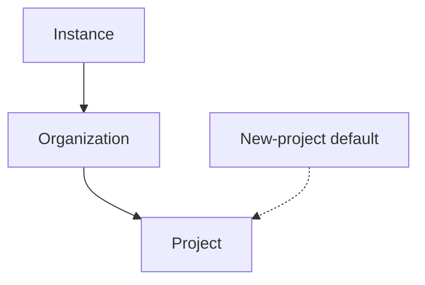

# Security Profiles

A security profile decides what each of Eve's hardening rules does. Profiles let stricter defaults arrive without breaking existing apps: you see what would change before anything does.

This page covers the profiles, how to check a project's readiness, and the checklist for building an app that runs under `strict`. An app built to the checklist runs unchanged under both `audit` and `strict`, so build for `strict` from the start.

## The three profiles

| Profile | What a hardening rule does |
|---------|----------------------------|
| `legacy` | Nothing: the old behaviour. **Deprecated in 0.1.330, removed in 0.1.331.** |
| `audit` | Keeps today's behaviour and records a finding for anything `strict` would refuse. A new instance starts here. |
| `strict` | Enforces the rule: the request gets a 403 (or the sync, deploy or job is refused) and a finding is recorded. |

:::note
`eve project sync --strict` and `eve manifest validate --strict` are unrelated to the `strict` profile. Those flags only make validation fail on missing secrets.
:::

## Where a profile is set

Profiles are set at four levels. Each level overrides the one above it:



- **Instance:** the system setting `security.profile`.
- **Organization:** overrides the instance.
- **Project:** overrides its organization.
- **New projects:** the system setting `security.new_project_profile`, when set, is written onto each project as it is created.

Only system admins set profiles:

```bash
eve system security profile audit                          # instance
eve system security profile strict --project proj_xxx      # one project
eve system security profile clear --project proj_xxx       # inherit again
eve system security profile strict --new-projects          # default for new projects
```

Each change is written to the audit log. Each rule follows the profile of the side it governs: a project's own resources follow the project, org-wide data (org files, docs and cloud-fs) follows the organization, and SSO identity rules follow the instance.

### Rule sets

Rules arrive one rule set per release: rule set 1 in 0.1.326, 2 in 0.1.327, 3 in 0.1.328 and 4 in 0.1.329. A `strict` profile is stamped with the rule set that was current when it was set. Rules newer than the stamp run as `audit` for that project, so an upgrade never starts enforcing new rules on a project that is already `strict`.

To take on the newer rules, check the project's findings and set `strict` again:

```bash
eve system security profile strict --project proj_xxx
```

### The `legacy` deprecation

- **0.1.330:** setting `legacy` still works but returns a warning. `eve doctor security` lists every level that resolves to `legacy`.
- **0.1.331:** every stored `legacy` becomes `audit`, an instance with no profile resolves to `audit`, and the API and CLI refuse `legacy` (400).

Before upgrading to 0.1.331, set each level that `eve doctor security` lists to `audit`. `audit` keeps today's behaviour and records what `strict` would refuse.

## Checking readiness

System admins read the security report with `eve doctor security`:

```bash
eve doctor security                       # every org and project
eve doctor security --project proj_xxx    # one project
eve doctor security --days 7 --json       # findings window in days (default 14, max 90)
```

The report shows each organization's and project's effective profile, findings grouped by rule, and, for each project not yet `strict`, a checklist line: `ready for strict`, or `not ready:` followed by what holds it back (findings in the window, or a cluster that does not enforce NetworkPolicy).

A finding records the rule, the organization and project, and who acted (a user, job, service, service principal or app link). It never records a value, token or request body.

A project whose report shows no findings for a few days of normal use can move to `strict`. Because network rules record nothing per connection under `audit`, ask your platform operator to compare allowed-flow logs with your declared hosts before a flip.

```bash
eve project sync                                         # job runners read egress hosts from the last explicit sync
eve system security profile strict --project proj_xxx   # enforce
eve system security profile audit --project proj_xxx    # back out, at once
```

## Building for strict

Work through each area below. Every change is safe under `audit`, so make them first and flip afterwards.

### Declare ingress on every service with ports

Under `strict`, a service is reachable from outside only when it says so.

| Manifest | `legacy` / `audit` | `strict` |
|----------|--------------------|----------|
| `x-eve.ingress.public: true` | Public | Public |
| An `x-eve.ingress` block without `public: true` | Private | Private |
| `ports` and **no** `x-eve.ingress` block | Public (`audit` records a finding) | Private: no Ingress, host, alias or domain, and the ingress controller cannot reach it |

:::warning
A routed service that relies on the implicit default becomes unreachable from outside when its project moves to `strict`. Write `public: true` or `public: false` on every service that lists `ports`.
:::

```yaml
services:
  web:
    ports: [8080]
    x-eve:
      ingress:
        public: true      # routed
        port: 8080
  api:
    ports: [3000]
    x-eve:
      ingress:
        public: false     # internal: reached by web inside the environment
```

The ingress controller reaches a routed service only on the port its Ingress routes to (`x-eve.ingress.port`, else the first port).

### Run as a numeric non-root user

Under `strict`, every service and every `x-eve.role: job` service (migrations included) runs with the restricted Pod Security context: `seccompProfile: RuntimeDefault`, no service account token, no privilege escalation, all capabilities dropped, `runAsNonRoot`, and a numeric user and group.

Eve takes the user from `x-eve.security.run_as_user` and `run_as_group`, or else from the image's own numeric `USER` (`uid` or `uid:gid`), which it reads from the image config. If the image's `USER` is a name (`USER node`), root or unset, or Eve cannot read the image config, the deploy or job is refused with a message naming these fields.

The simplest fix is a numeric `USER` in the Dockerfile:

```dockerfile
USER 1000:1000
```

Or set the user in the manifest:

```yaml
services:
  api:
    build: { context: ./apps/api }
    ports: [3000]
    x-eve:
      ingress: { public: false }
      security:
        run_as_user: 1000     # matches USER node in the Dockerfile
        run_as_group: 1000
```

| Field | Description |
|-------|-------------|
| `run_as_user` | Numeric uid. Wins over the image's own `USER`. |
| `run_as_group` | Numeric gid. |
| `run_as_root` | `true` lets the containers run as root. The other controls stay. |
| `capabilities` | Added back after dropping all: `NET_BIND_SERVICE`, `CHOWN`, `SETUID`, `SETGID`, `DAC_OVERRIDE`. |

- A non-root process that binds a port below 1024 needs `capabilities: [NET_BIND_SERVICE]`. Otherwise, listen on port 1024 or above.
- `run_as_root`, or any capability beyond `NET_BIND_SERVICE`, puts the namespace at Pod Security level `baseline` instead of `restricted`.
- Unknown fields under `x-eve.security` fail manifest validation.
- Stable egress (`x-eve.networking.egress: stable`) is refused under `strict`.
- Check images you do not build too. Eve's migrate image sets no `USER`, so a migration service that uses it needs `run_as_user` and `run_as_group`.

The stock nginx image runs as root on port 80. Either use an nginx image that runs as a numeric non-root user on a port of 1024 or above, or opt out:

```yaml
services:
  web:
    image: nginx:1.27-alpine
    ports: [80]
    x-eve:
      ingress: { public: true, port: 80 }
      security:
        run_as_root: true
        capabilities: [NET_BIND_SERVICE, CHOWN, SETUID, SETGID]
```

### Declare the internet hosts you call

Under `strict`, a project's pods reach DNS, the namespace itself, the Eve API's public port, the ingress controller, the environment's managed databases, the app-link producers the project consumes, and the internet outside private address ranges. Private addresses, the cloud metadata server and other tenants' namespaces are out of reach.

From rule set 3 (host allow lists), internet access is limited to the hosts the manifest declares:

```yaml
x-eve:
  egress:
    hosts:                               # every pod in every environment, and the project's job runners
      - api.example.com                  # port 443
      - "*.cdn.example.com"              # exactly one label under cdn.example.com
      - { name: smtp.example.com, port: 587 }
      - { pattern: "*.hooks.example.com", port: 8443 }

services:
  web:
    x-eve:
      egress:
        hosts: [payments.example.com]    # this service's pods only
```

- An entry is a host name, a `*.` pattern (the `*` matches exactly one label), or an object with `name` or `pattern` and an optional TCP `port` (default 443). Each list holds at most 50 entries.
- Sync refuses schemes, paths, ports inside the string, a bare `*`, a `*` outside the first label, patterns over a top-level domain, IP addresses, single-label and cluster names (in-cluster peers need no entry), wildcard DNS services such as `nip.io`, and names that resolve to a private or reserved address.
- Job runners also reach the model APIs of the harnesses the project can run, and the repository's git host, without an entry. Apps do not.
- A custom model base URL (such as `ANTHROPIC_BASE_URL`), Vertex AI, or a Google sign-in for Gemini goes in the manifest list.
- A job that names a harness the project cannot run (no harness profile names it and no secret is its credential) gets no route to its API. Declare a harness profile for it.

| Harness | Hosts job runners reach |
|---------|-------------------------|
| `claude`, `mclaude` | `api.anthropic.com` |
| `zai` | `api.z.ai` |
| `gemini` | `generativelanguage.googleapis.com` |
| `codex`, `code` | `api.openai.com`, `chatgpt.com`, `auth.openai.com` |
| `pi` | `api.anthropic.com`, `api.openai.com`, `generativelanguage.googleapis.com`, `api.z.ai` |

:::tip
Job runners take the project list from the manifest of the last explicit `eve project sync`; a deploy never marks its manifest as synced. Run `eve project sync` after changing hosts, and before moving to `strict`. Services take their lists from the release the environment runs, so redeploy too.
:::

Host allow lists need an enforcement provider on the instance (`EVE_EGRESS_FQDN_PROVIDER`). Without one, a `strict` project's deploys and jobs fail with "egress allow lists need a provider (EVE_EGRESS_FQDN_PROVIDER)". Ask your platform operator, and keep the project on `audit` until it is set. Only IPv4 egress is allowed.

### Cross-project traffic and ingress isolation

From rule set 3, a `strict` project's pods accept connections only from:

- the Eve API, which fetches app API specs, delivers webhooks to private targets and runs `eve db` queries;
- the project's own environment namespaces and job runners;
- the ingress controller, to a service that has an Ingress, on the port it routes to;
- consumers of an [app link](./fullstack-app-design.md#cross-project-app-links) with a live API grant for that environment, to the granted service, on the link's port.

So in-cluster calls from another project must go through an app link (`x-eve.app_links`), public TCP listeners (`x-eve.tcp_ingress`) are not admitted, and NetworkPolicies your project writes to restrict traffic between its own pods no longer hold, because Eve's policies admit the project's own namespaces to every pod.

### Connect to managed databases with declared roles

From rule set 3, a long-running service whose `environment`, `command` or `entrypoint` reads the database owner's `${managed.<db>.url}` or `${managed.<db>.password}` is refused at deploy. Declare a role and use its URL. Migration jobs (`x-eve.role: job`) still receive the owner credential.

```yaml
services:
  api:
    environment:
      DATABASE_URL: ${managed.db.roles.app.url}    # declared role
  migrate:
    environment:
      DATABASE_URL: ${managed.db.url}              # owner: job services only
    x-eve:
      role: job
  db:
    x-eve:
      role: managed_db
      managed:
        class: db.p1
        engine: postgres
        engine_version: "16"
        roles:
          - name: app
            grants: readwrite                      # or readonly
          - name: auth
            grants: { schema: auth, owner: true }  # owns one schema
```

- `readwrite` and `readonly` roles get grants in `public`, including on tables the owner creates later, but cannot create objects. Run migrations with the owner URL in a job service.
- A schema-owner role (`grants: { schema: <name>, owner: true }`, from 0.1.330) suits a component that runs its own migrations in its own schema, such as an auth server.
- A database declares at most 8 roles.
- Each login gets its class's connection limit: 25 for `db.p1`, 100 for `db.p2` and 200 for `db.p3`. Size connection pools within it. See [Database Operations](/docs/operations/database) for the details, including how limits an operator set are kept.

### Jobs and agents

- **Runner pods:** agent jobs, `script:` steps and `action: { type: run }` run in runner pods that hold no platform credential. A legacy pipeline-runner `run` step gets 400 ("use a `script:` step"). Runner pods mount no org filesystem.
- **Declared secrets:** a job whose agent (`access.secrets`) and workflow step (`secrets:`) declare no allowlist receives only its harness provider keys and the keys its env overrides reference. Declare the secrets each job needs. Starting such work needs the `secrets:use` permission.
- **Harness selection:** name a harness or harness profile, or set `x-eve.defaults.harness_preference`; otherwise the job fails at dispatch ("no harness configured"). Harness credentials count only from project, org, system or job-actor secrets.
- **Reserved environment names:** env overrides may not set `LD_PRELOAD`, `LD_LIBRARY_PATH`, `DYLD_*`, `BASH_ENV`, `ENV`, `PYTHONPATH` or `PYTHONSTARTUP`, and may set `SSL_CERT_DIR`, `REQUESTS_CA_BUNDLE` and `CURL_CA_BUNDLE` only to a single `${secret.KEY}`.
- **Checkout settings:** a run is refused, naming the file and setting, when the repository's harness settings reroute model traffic or hand a credential to an MCP server. See [Harnesses & Workers](/docs/reference/harnesses-and-workers).
- **Approvals:** approving or rejecting a job, and `eve pipeline approve`, need a person's own token; job, service, service-principal and app-link tokens get 403.
- **Chat:** chat starts agent work only for a sender who maps to an Eve user with `jobs:write` on the project.

### Secrets and permissions

- Secret values are write-only: `eve secrets export` gets 403. `eve secrets ensure` shows a generated value once, in its own response.
- A system secret reaches the project only when the instance shares it by name (`secrets.system_shared_keys`). Otherwise set it at org or project scope.
- A job may update only a project-scope copy of a credential it refreshes, never the org's. Keep a project-scope copy of such credentials, for example `CODEX_AUTH_JSON_B64`.
- Each project needs its own `GITHUB_WEBHOOK_SECRET` (`eve github setup`).
- `secrets:use`, `envdb:export` and `jobs:harness_override` come only from admin and owner roles, bindings and custom roles. Grant them before the flip:

```bash
eve access roles create operator --org org_xxx --scope project --permissions secrets:use,envdb:export,jobs:harness_override
eve access bind --org org_xxx --project proj_xxx --user user_xxx --role operator
```

- An org `member` gets nothing on a project from the org role alone. Add a project membership or a binding.

See [Secrets & Credentials](./secrets.md) for more.

### Remove environment approval

Eve has no deploy approval gate: deploys never wait for a person, whatever `environments.<env>.approval` says. From rule set 4, `strict` sync refuses (400) an `approval` that asks for a gate (any value other than `none` or blank). Remove the key.

### Apps that use Eve SSO

When the instance is `strict`, the SSO serves `/session` to an app only from one of its own project's `https` hosts, only for people the app's access policy admits, and returns a one-hour **app audience token** instead of the platform token. Upgrade `@eve-horizon/auth` before the instance moves to `strict`. See [Authentication](./authentication.md).

## A strict-ready manifest

```yaml
name: acme-app
schema: eve/compose/v2
registry: "eve"

x-eve:
  egress:
    hosts:
      - api.example.com

services:
  api:
    build: { context: ./apps/api }     # Dockerfile ends with USER 1000:1000
    ports: [3000]
    environment:
      DATABASE_URL: ${managed.db.roles.app.url}
    x-eve:
      ingress:
        public: false

  web:
    build: { context: ./apps/web }     # non-root web server on 8080, numeric USER
    ports: [8080]
    x-eve:
      ingress:
        public: true
        port: 8080

  migrate:
    image: public.ecr.aws/w7c4v0w3/eve-horizon/migrate:latest
    environment:
      DATABASE_URL: ${managed.db.url}
      MIGRATIONS_DIR: /migrations
    x-eve:
      role: job
      security:
        run_as_user: 1000
        run_as_group: 1000
      files:
        - source: db/migrations
          target: /migrations

  db:
    x-eve:
      role: managed_db
      managed:
        class: db.p1
        engine: postgres
        engine_version: "16"
        roles:
          - name: app
            grants: readwrite

environments:
  staging:
    pipeline: deploy
```

## Troubleshooting

| Symptom | Fix |
|---------|-----|
| A routed service has no host after the flip | Add `x-eve.ingress.public: true` (and `port`), then redeploy |
| Deploy or job refused, naming `x-eve.security.run_as_user` | Set a numeric `USER` in the Dockerfile, or `run_as_user` and `run_as_group` |
| Deploy refused for `networking.egress: stable` | Remove stable egress from the service |
| Deploy refused, naming `${managed.<db>.roles.<role>.url}` | Declare a database role and use its URL in long-running services |
| "egress allow lists need a provider (EVE_EGRESS_FQDN_PROVIDER)" | Your platform operator must configure the provider; keep the project on `audit` until then |
| Calls to an internet host time out | Add the host to `x-eve.egress.hosts`, run `eve project sync`, and redeploy |
| Another project's in-cluster calls are refused | Export the API through an app link with a grant for that environment |
| Sync 400: "Environment approval gates are not enforced by Eve" | Remove `environments.<env>.approval` |
| Job fails with "no harness configured" | Name a harness or profile, or set `x-eve.defaults.harness_preference` |
| Run fails, naming a checkout settings file | Remove the routing or credential setting from that file |
| Job fails with "egress policy not enforced" | The cluster does not enforce NetworkPolicy; contact your platform operator |
| `eve secrets export` returns 403 | Values are write-only under `strict` |
| A job no longer receives a secret | Declare it in the agent's `access.secrets` or the step's `secrets:` |

## What's next?

- **[Manifest Authoring](./manifest-authoring.md)** — services, ingress and the rest of the manifest.
- **[Services & Databases](./services-and-databases.md)** — managed databases, roles and service configuration.
- **[Security & Key Rotation](/docs/operations/security)** — the platform security model.
